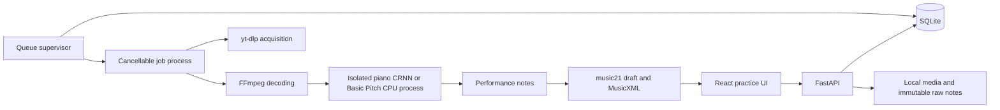

# Piano AI architecture

The browser is the practice instrument; the Windows host owns media, storage, and CPU transcription. There is no paid service or account dependency.

## Timing and audio

`raw.notes` is immutable. Notes have stable IDs, MIDI pitch, onset/end seconds, velocity where available, and estimated hand assignment. MIDI CC64 sustain events are preserved separately. The piano CRNN estimates note attacks, releases, velocity, and sustain pedal. Basic Pitch's amplitude-derived velocity is labeled in provenance; it supplies neither calibrated confidence nor pedal events here. Model activations are evidence used by the decoder, not calibrated probabilities that a note is correct.

Corrections are an overlay. `notes` is the effective performance; `score` is the derived quantized representation. Tempo anchors map seconds to quarter-note beats and back. Manual downbeat alignment shifts this mapping, not the performance. The score includes a fragment-to-note map for tied notes. OSMD cursor positions and notehead elements are collected after each render, including resize and transpose, so measure seeking and highlighting retain explicit links to the performance.

`domain.prepare_notes` applies manual corrections and cleanup, then estimates hands for audio transcriptions using surrounding note patterns and chord ranges. Raw hand labels are only initial pitch-based guesses; the effective notes and score use the contextual result. Explicit corrections constrain automatic hand inference. Demo and MIDI hand labels are preserved. The same preparation runs when score generation falls back to a piano roll. The `handAssignment` summary records the method/version for the saved revision.

Audio-only cleanup is another reversible overlay, controlled by `settings.cleanup` (off/balanced/strong). The model runners preserve their detected candidates and return note evidence separately from `raw.notes`. Filtering is model-specific: Balanced preserves piano CRNN detections, while Strong requires a combination of weak onset support, low velocity, and short duration before hiding a piano note. Basic Pitch's activations and amplitude-derived velocity use separate thresholds. Manual corrections bypass automatic filtering; explicit deletions still apply. Older Basic Pitch pieces without evidence use duration/strength filtering, and MIDI/demo data is never filtered. `piece.cleanup` records hidden IDs and reasons. Saved revisions and their effective piece are committed together.

Score groups have an explicit ordering for tied and untied events sharing a position/duration. After engraving, repeated note IDs created by music21's duration splitting receive unique segment IDs; fragments retain `xmlIds` linking all segments. Score-generation failures return a specific JSON error and leave the saved piece unchanged.

The synthetic mode uses an AudioContext clock and a short scheduling lookahead. Each note has its own sampled voice, so releasing a repeated pitch cannot terminate another voice. Stop, seek, loop, and mode changes flush both voices and future events. Original audio follows HTMLMediaElement.currentTime; YouTube follows its IFrame player clock and supported rates. Exactly one playback source is active. Inactive tabs pause deliberately; resuming reanchors rather than catching up a stalled animation timer.

The piano sampler uses native Web Audio with seven local piano recordings, interpolated across pitches. This replaces the originally proposed Tone.js wrapper so individual overlapping note voices can be controlled directly. Canvas and keyboard share one white/black-key geometry. Playback transpose affects the sampler, roll, and rendered score; exports remain at the saved pitch.

## API and worker

FastAPI exposes `/api/health`, `/api/sources/upload`, `/api/sources/youtube`, `/api/jobs`, job status/retry/cancel, `/api/pieces`, piece revisions, deletion, media, and MIDI/MusicXML exports. `/docs` is interactive API documentation; `docs/openapi.json` and generated frontend types record the request contracts.

The library uses the same draft-option component as Practice settings. Its selected piece and unsaved options are separate from the currently playing piece. Applying options saves a revision to that piece; cancelling discards draft changes. Re-transcribing saved audio instead queues a new inference job using those settings and creates a new piece, leaving the original piece and its edits untouched. Deletion has a confirmation dialog, and deleting the currently open piece stops playback and opens the bundled demo.

`DELETE /api/pieces/{id}` atomically removes the saved piece and revision history, clears completed-job references, and queues deletion of its exclusive `data/pieces/{id}` directory. Paths are resolved and checked before recursive removal. Locked files remain in a durable cleanup queue and are retried on startup. Shared source uploads, acquisition caches, and job history are retained. Late rename or regeneration requests cannot recreate a deleted piece; the bundled demo cannot be deleted.

SQLite uses WAL, parameterized queries, and transactional job claiming. The supervisor permits one active CPU job. It writes heartbeats and launches one process tree per job. Cancellation kills the job's FFmpeg/model children. An interrupted worker job becomes retryable after its 30-second stale-heartbeat window. A retry gets a new job ID. Results are inserted transactionally only when the job is still running and not cancelled.

Model imports are isolated from the API's `.venv`: the piano-specific CRNN uses `.venv-piano`, and the optional Basic Pitch fallback uses `.venv-model`. The app prefers the piano model when installed. A stage marker reports when model loading finishes. CPU inference is the supported path; GPU configuration is not required or verified. Acquisition and inference have separate failure messages. Downloaded media is never obtained from the YouTube IFrame API.

`python -m scripts.setup_piano` installs the pinned Windows x64/Python 3.11 environment and downloads the original 171,966,578-byte checkpoint from Zenodo. The installer streams the file to a temporary sibling, verifies the pinned SHA-256, then replaces the destination atomically. Interrupted or invalid downloads leave the existing checkpoint intact. No upstream `wget` command is used. `.tools/models/piano-crnn.pth` is the default checkpoint; `PIANO_CRNN_PYTHON` and `PIANO_CRNN_CHECKPOINT` can select preinstalled runtime alternatives. `scripts.doctor` checks both model environments and verifies the official checkpoint digest.

Basic Pitch is distributed under Apache-2.0, with its packaged pretrained ICASSP 2022 model. The CRNN Python distribution declares MIT; the original training repository declares Apache-2.0; its released weights are CC BY 4.0. Attribution and original links are recorded in `THIRD_PARTY_NOTICES.md`. Model files stay in ignored project tool/environment directories, not browser assets. Music21 handles MusicXML generation without installing a desktop score editor. Piano sample attribution and the CC BY 3.0 link are bundled and exposed from Practice settings.

## Data and boundaries

`data/piano.sqlite3` holds pieces, sources, jobs, revision history, pending file deletions, arrangement source snapshots, and arrangements. Source uploads, job logs, immutable raw JSON, and normalized source audio are stored under UUID paths. Back up the entire `data` directory while the server/worker are stopped. Schema version 3 adds arrangement tables and an index automatically at startup, preserving version 2 library data and its file-deletion queue.

The backend serves the built app on one origin. There is no authentication in this single-user LAN version; do not expose it to the public internet. File uploads have a 500 MiB / 60-minute default limit. yt-dlp accepts only normalized, validated YouTube video links, ignores local downloader configuration and plugins, and does not use cookies or authentication workarounds.

The PWA cache contains the app shell, hashed build assets, original demo, and local piano samples. It deliberately excludes all API/media routes. Saved user pieces and uploads are not promised offline. A backend outage does not substitute demo notes for a submitted recording.

## Arrangement layer

`backend.arrangement` operates on effective source notes after corrections, cleanup, and hand assignment. It uses a bounded continuity beam, durations, register, repeated interval/rhythm cells, accents, and duration-weighted local harmony. Harmonic hysteresis prevents accompaniment steps from automatically becoming chord changes. Melody remains in source seconds; accompaniment reductions, octave revoicing, and earlier releases have explicit explanations and source-note links. Simultaneous-note/span measurements use half-open key-down intervals, excluding pedal sustain. Heuristic ambiguity flags are not calibrated confidence probabilities.

Generation uses a musical-content fingerprint and commits its source snapshot and arrangement in one transaction after rechecking the source. Titles are excluded from the fingerprint. Snapshots include effective notes, edits, shared guidance, score settings, anchors/measures, pedal events, recording offset, and duration. Regeneration creates a new arrangement with a predecessor ID. Piece deletion removes arrangements before their snapshots; generation cannot resurrect deleted pieces. Source changes mark existing arrangements outdated without modifying their notes or comparison baselines.

The `/api/pieces/{id}/arrangements` collection supports generation/listing, with read/delete on individual IDs. `PUT /api/pieces/{id}/guidance` saves version-checked melody/accompaniment labels and protected source IDs. Export routes accept `arrangementId`; omitted IDs retain the existing full-transcription behavior. Invalid fingerprints return 409, and generation/engraving failure commits nothing.

Frontend `PerformanceView` is shared by the sampler, score, and roll/keyboard. A/B comparison swaps the selected arrangement and its frozen source view without resetting speed, position, loop, hand selection, or transpose, and flushes scheduled voices. Pedals belong to that view. MusicXML reuses source measure boundaries and canonical part/instrument IDs. MIDI retains the source-duration end-of-track silence. Corrections made from arrangement notes target source IDs, not transformed pitches. Late API responses from another piece cannot select its arrangement.
